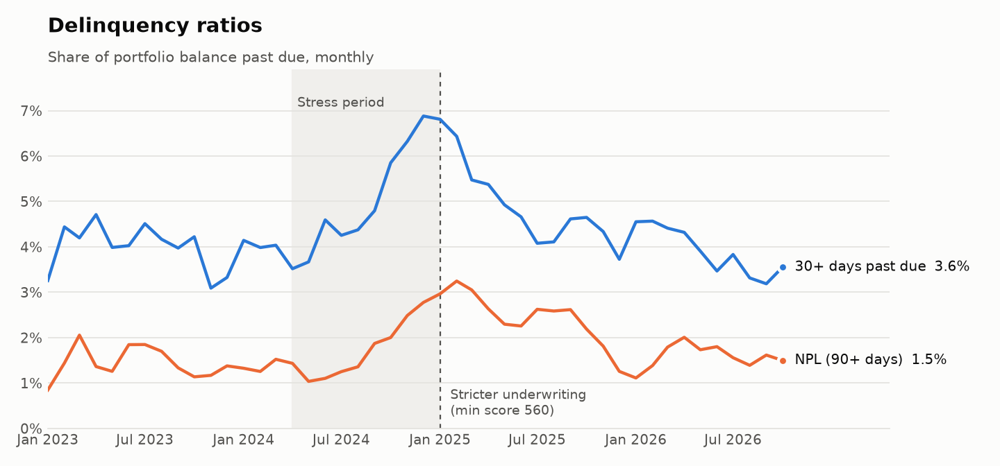
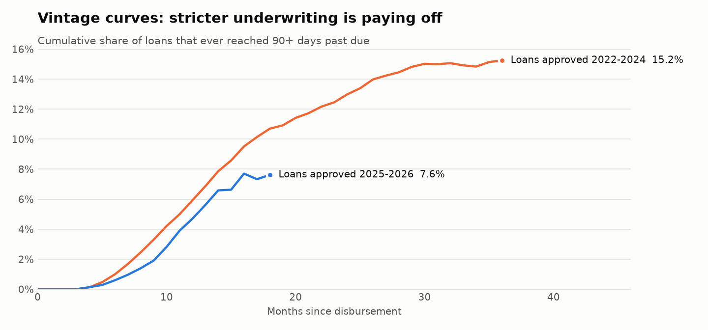
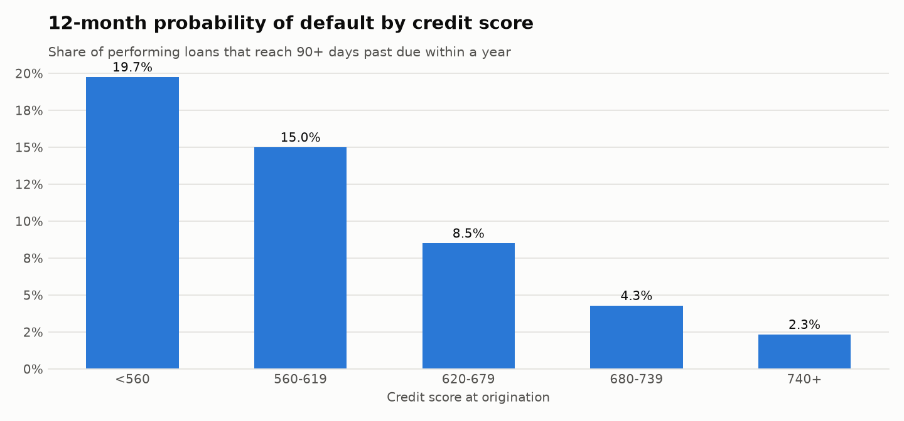
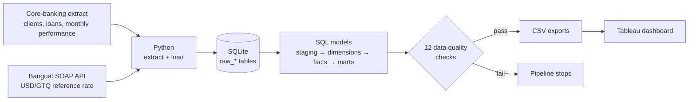
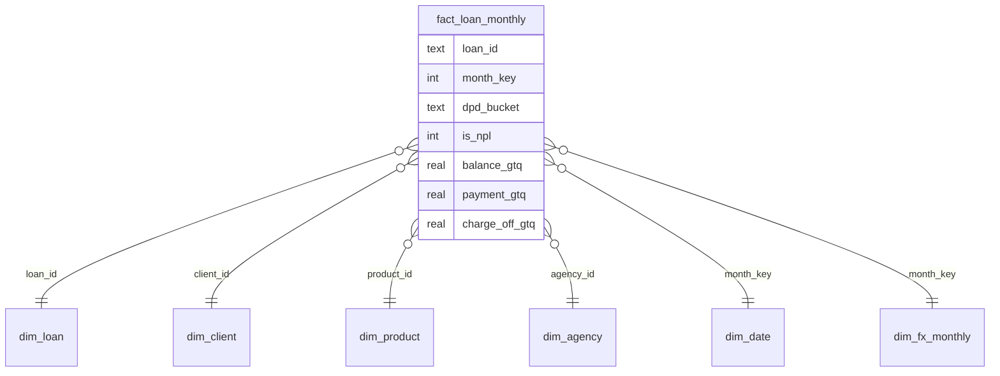

# Credit Risk Analytics Pipeline — Banking Portfolio

An end-to-end data pipeline that turns raw core-banking extracts into credit-risk KPIs for a
(fictional) Guatemalan bank: **delinquency, non-performing loans (NPL), vintage curves, roll rates,
probability of default and expected loss**, with live USD/GTQ exchange rates from **Banco de Guatemala**.

**Stack:** Python · SQL (SQLite) · pandas · REST/SOAP API · pytest · GitHub Actions · Tableau



---

## The business problem

A retail bank's risk committee needs to answer, every month:

1. **How healthy is the loan book?** How much is past due, and is it getting better or worse?
2. **Did the January 2025 credit-policy change work?** The bank raised its minimum credit score from 500 to 560.
3. **Where is the risk concentrated?** By product, region and customer profile.
4. **How much do we expect to lose?** To set aside provisions (reserves) for bad loans.
5. **How exposed are we to the exchange rate?** About a third of the portfolio is lent in US dollars.

This project builds the pipeline that answers those questions automatically and feeds a dashboard.

## Key findings (October 2026)

| KPI | Value | Change |
|---|---|---|
| Portfolio balance | Q298.8M | +21.6% year over year |
| NPL ratio (90+ days past due) | **1.50%** | down from 2.19% a year ago (peak 3.25% in Feb 2025) |
| 30+ days delinquency | 3.55% | down from 4.65% a year ago |
| Expected loss | Q8.5M (2.86% of portfolio) | |

- **The stricter policy is working.** After 18 months on book, 7.6% of loans approved under the 2025 policy had
  reached 90+ days past due, versus 10.7% for earlier loans: **29% fewer defaults**.
- **Credit score is the strongest risk driver.** Borrowers below 560 default within 12 months at 19.7%, about
  **8.5× the rate** of borrowers above 740 (2.3%).
- **Collections should act early.** 41% of loans 1-30 days late cure the next month, but 30% roll to 31-60 days.
  Once a loan passes 90 days, only 3% return to current.
- **SME lending drives the expected loss.** It is a third of the portfolio but carries a 5.0% expected-loss rate,
  making it the largest contributor to provisions (58% of total expected loss).
- **31% of the portfolio is in US dollars**, converted at Banguat's month-end rate (Q7.64 per USD in October 2026),
  so exchange-rate moves change the reported balance even when no loan changes.





> All loan data is **synthetic** (generated with realistic risk drivers), because real loan-level banking
> data is confidential. Exchange rates are real: they come from the official Banco de Guatemala web service.

---

## Architecture



| Step | What happens | Code |
|---|---|---|
| **Extract** | Simulates the core-banking extract; downloads daily FX rates from Banguat (falls back to a simulated series if offline) | `src/generate_data.py`, `src/extract_fx.py` |
| **Load** | Saves raw CSV files and loads them into `raw_*` tables | `src/load.py` |
| **Transform** | Four SQL layers build a star schema and business-ready marts | `sql/01_staging.sql` … `sql/04_marts.sql` |
| **Quality** | 12 checks (referential integrity, no duplicates, balances reconcile, valid ratios…); any failure stops the run | `src/quality.py` |
| **Export** | Writes every `mart_*` table to CSV for the BI tool | `src/export.py` |

## Data model (star schema)



**Grain of the fact table:** one row per loan per month (~105,000 rows for 6,000 loans).

### Marts (exported to `exports/`)

| Table | Answers |
|---|---|
| `mart_kpi_summary` | Headline KPIs vs previous month and same month last year |
| `mart_portfolio_monthly` | Balance, delinquency, NPL, disbursements, collections and charge-offs by month × product × region |
| `mart_vintage_curves` | Cumulative % of loans reaching 90+ DPD by origination quarter and months on book |
| `mart_roll_rates` | Probability of moving between delinquency buckets month to month (last 12 months) |
| `mart_pd_by_segment` | 12-month probability of default by product × credit score band |
| `mart_loan_snapshot` | Latest month, one row per active loan, with PD, LGD and expected loss |
| `mart_fx_exposure` | USD balances, share of portfolio and FX revaluation effect |

### KPI definitions

| KPI | Definition |
|---|---|
| **NPL ratio** | Balance of loans more than 90 days past due ÷ total active balance |
| **30+ delinquency ratio** | Balance more than 30 days past due ÷ total active balance |
| **Vintage curve** | For loans originated in the same quarter: % that have *ever* been 90+ DPD or charged off, by months since disbursement |
| **Roll rate** | % of loans in a bucket this month that are in each bucket next month |
| **PD (12 months)** | % of performing loan-months that reach 90+ DPD or charge-off within the next 12 months; small segments are blended toward the product average (credibility weighting) |
| **Expected loss** | EAD × PD × LGD — balance × probability of default × loss given default (a simplified IFRS 9 / Basel approach; PD = 100% for loans already NPL) |
| **FX revaluation** | Last month's USD balance × change in the month-end exchange rate |

---

## How to run it

Requires Python 3.10+. No database server needed: SQLite ships with Python.

```bash
git clone https://github.com/pabloanalyst1/banking-credit-risk-pipeline.git
cd banking-credit-risk-pipeline
python -m venv venv && source venv/bin/activate   # Windows: venv\Scripts\activate
pip install -r requirements.txt

python run_pipeline.py            # full run with live Banguat exchange rates (~5 s)
python run_pipeline.py --offline  # without internet
python -m pytest                  # run the tests
python scripts/make_readme_charts.py  # regenerate the README charts
```

Options: `--loans 20000` simulates a bigger portfolio, `--seed 7` produces a different (but reproducible) one.

The warehouse is written to `data/warehouse.db`. Open it with any SQLite client (for example DB Browser for SQLite)
to explore the tables with SQL.

## Dashboard

The CSV files in `exports/` feed a Tableau Public dashboard. See the
[dashboard guide](docs/tableau_dashboard_guide.md) for the layout and calculated fields.

## Project structure

```
├── run_pipeline.py            # orchestrates the 5 steps
├── src/
│   ├── config.py              # dates, policy rules, paths
│   ├── generate_data.py       # synthetic core-banking extract (risk-driven simulation)
│   ├── extract_fx.py          # Banguat SOAP client + offline fallback
│   ├── load.py                # raw files and raw_* tables
│   ├── transform.py           # runs the SQL models in order
│   ├── quality.py             # data quality checks
│   └── export.py              # marts to CSV
├── sql/                       # staging → dimensions → facts → marts
├── tests/                     # unit + end-to-end tests
├── scripts/make_readme_charts.py
├── exports/                   # dashboard-ready CSV files
├── docs/                      # dashboard guide and charts
└── .github/workflows/         # CI: tests + pipeline run on every push and monthly
```

## Design decisions

- **SQLite instead of a database server.** Anyone can clone and run the project in a minute. The SQL is standard
  (window functions, CTEs, recursive CTEs), so it moves to PostgreSQL or SQL Server with minor changes.
- **Layered SQL (staging → dimensions → facts → marts).** The same pattern used in dbt projects: each layer has one
  job, and the BI tool only reads clean marts.
- **Numerators and denominators are exported, not only ratios.** Averaging ratios across regions gives wrong
  answers; the dashboard re-aggregates `SUM(npl_balance) / SUM(portfolio_balance)`.
- **Month-end exchange rate for balances.** USD loans are converted at the closing rate, as on a balance sheet.
- **The pipeline fails loudly.** If a quality check fails, nothing is exported, so the dashboard never shows bad data.
- **Performance.** The first version took 62 seconds; materializing the staging layer as indexed tables cut the run to ~5 seconds.

## Possible next steps

- Move the warehouse to PostgreSQL and the SQL models to dbt.
- Replace the score-band PD with a logistic-regression scorecard.
- Add IFRS 9 staging (Stage 1/2/3) and lifetime expected loss.
- Schedule the pipeline with Airflow.

---

**Author:** José Pablo Arizandieta · [LinkedIn](https://www.linkedin.com/in/pablo-arizandieta) · [GitHub](https://github.com/pabloanalyst1)
